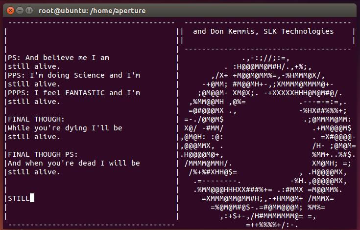
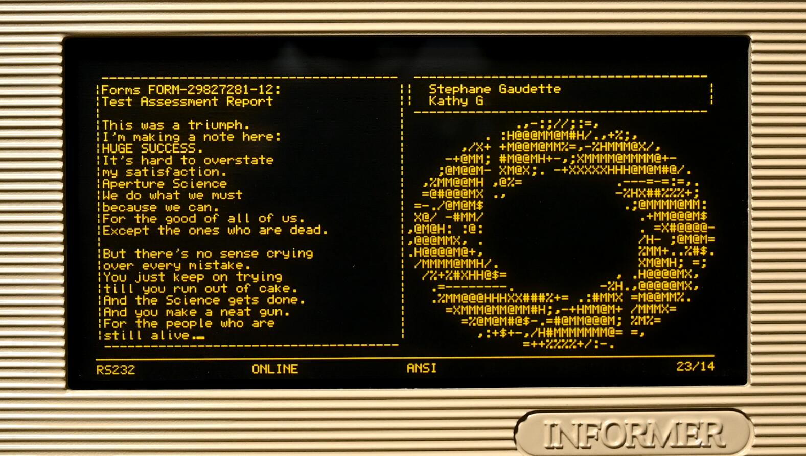

在终端上演示《传送门》片尾曲效果的 Python 脚本程序。

## 使用条件

`still_alive_credit.py` 脚本使用 Python 3，以下提到的 `pip` 多数情况下对应 `pip3` 命令
以调用 Python 3 的 `pip` 组件。

Windows 下需要使用 Windows terminal，MinTTY 等支持 ANSI 终端转义序列的终端模拟器。

播放音乐依赖 [playsound3](https://pypi.org/project/playsound3/)，需要使用 `pip install playsound3` 来安装。
参见其文档，在不同平台下可能需要进行相应配置、安装来确保声音正常播放，在 Linux 下可能依赖 `python-gobject` 软件包（Ubuntu 已默认安装）。
在 MacOS 下可能需要用 `pip` 安装 `PyObjC`。

如果使用 [uv](https://docs.astral.sh/uv/)，可以在自动创建的临时环境中运行而不用手动安装依赖: `uv run --with playsound3 still_alive_credit.py`。

## 使用方法

在当前目录下执行：

```
python3 still_alive_credit.py
```

脚本会读取 `TERM`，`COLUMNS` 和 `LINES` 环境变量来调整输出区域大小并决定是否启用终端颜色等
特性。如果希望在一台标准 VT100 终端上演示，应该运行：

```
TERM=vt100 python3 still_alive_credit.py
```

可以使用`--no-stay`参数使得播放完音乐后自动退出，默认是停留在播放完的界面。你也可以按`Ctrl+C`退出

可以使用 `--no-sound` 参数不带音乐进行演示，此时脚本只依赖 Python 标准库：

```
python3 still_alive_credit.py --no-sound
```

---

A demo of the credit song 'Still Alive' of Portal 1 written in Python, running
in text terminal.

## Dependency

`still_alive_credit.py` is written with Python 3. In most cases the following
`pip` should be `pip3` command.

In Windows system, you need a teminal emulator supporting ANSI escape sequences
like Windows Terminal, MinTTY, Cmder or ConEmu。

For playing music, you need install [playsound3](https://pypi.org/project/playsound3/) with `pip`.
Please read its document to know how to configure the backends. On Linux you may need to install
`python-gobject` (default installed in Ubuntu). In MacOS you may need to use `pip` to install `PyObjC`.

With [uv](https://docs.astral.sh/uv/), you can run the script in a temporary environement and
no need to manually install the dependencies: `uv run --with playsound3 still_alive_credit.py`.

## Usage

In current directory, execute:

```
python3 still_alive_credit.py
```

The script will read environment variable `TERM`, `COLUMNS` and `LINES` to determine
the output area size and whether to enable features such as terminal color. If you
want run it on a standard VT100 terminal, you should execute:

```
TERM=vt100 python3 still_alive_credit.py
```

You can use the `--no-stay` option to automatically exit after the music finishes playing. By default, it remains on the playback screen. You can also press `Ctrl+C` to exit.

It's able to use `--no-sound` option to run the script without playing sound. In this
case, the script only depends on Python standard library:

```
python3 still_alive_credit.py --no-sound
```

## Linux 运行效果 / Snapshot on Linux



## 演示视频 / demonstration video



<https://www.bilibili.com/video/BV1cU4y1A7ud>
